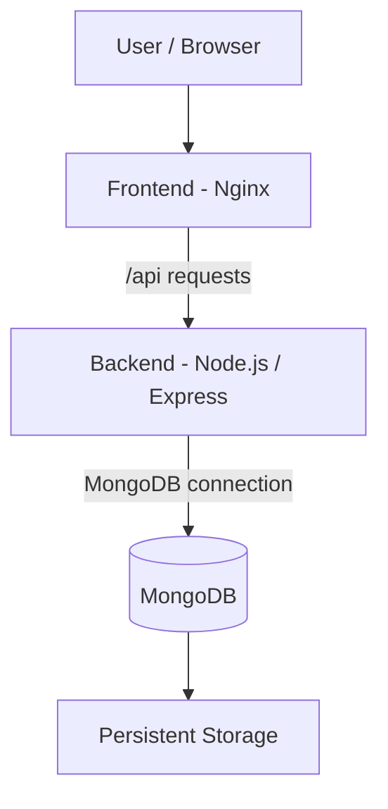
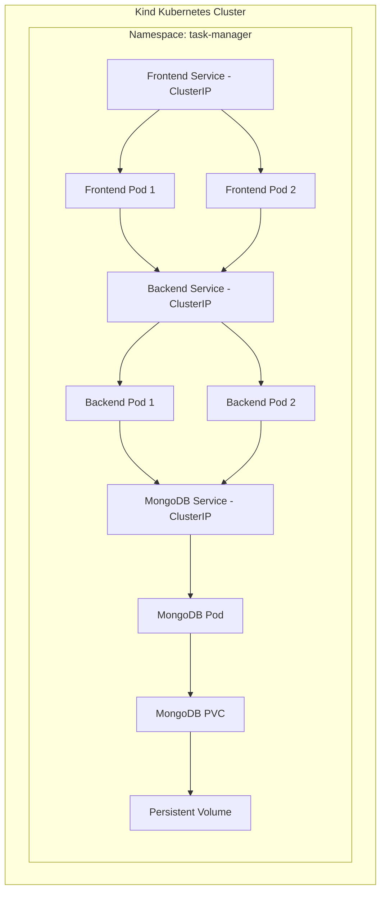

# Task Manager — DevOps Platform

An end-to-end DevOps learning project that demonstrates how to build, containerize, publish, deploy and manage a three-tier application using Docker and Kubernetes.

The project starts with a Task Manager application and progressively introduces Docker, Docker Compose, Docker Hub, Kubernetes and Kind.

## Project Overview

The application consists of three components:

- **Frontend:** HTML, CSS and JavaScript served through Nginx.
- **Backend:** Node.js and Express REST API.
- **Database:** MongoDB for persistent task storage.

The frontend communicates with the backend through an Nginx reverse proxy. The backend communicates with MongoDB through internal service networking.

## Architecture



### Kubernetes Architecture



The diagrams represent the intended internal architecture. External access is being developed as part of the upcoming Kubernetes networking phase.

## Technology Stack

| Area | Technologies |
|---|---|
| Frontend | HTML, CSS, JavaScript |
| Backend | Node.js, Express |
| Database | MongoDB, Mongoose |
| Web server | Nginx |
| Containerization | Docker |
| Local orchestration | Docker Compose |
| Image registry | Docker Hub |
| Container orchestration | Kubernetes |
| Local Kubernetes | Kind |
| CLI tools | kubectl, Docker CLI |

## Repository Structure

```text
task-manager-devops-platform/
├── frontend/
│   ├── index.html
│   ├── style.css
│   ├── app.js
│   ├── Dockerfile
│   └── nginx.conf
│
├── backend/
│   ├── src/
│   │   └── server.js
│   ├── package.json
│   ├── package-lock.json
│   └── Dockerfile
│
├── kubernetes/
│   ├── kind-config.yaml
│   ├── namespace.yaml
│   ├── mongodb/
│   ├── backend/
│   └── frontend/
│
├── docker-compose.yml
├── docs/
└── README.md
```

## Application API

| Method | Endpoint | Description |
|---|---|---|
| GET | `/api/tasks` | Retrieve tasks |
| POST | `/api/tasks` | Create a task |
| PUT | `/api/tasks/:id` | Update a task |
| DELETE | `/api/tasks/:id` | Delete a task |
| GET | `/health` | Backend health endpoint |

## Implementation Journey

### Phase 1 — Application Development

- Developed a three-tier Task Manager application.
- Implemented frontend functionality.
- Built REST APIs using Node.js and Express.
- Integrated MongoDB using Mongoose.

### Phase 2 — Dockerization and Docker Compose

- Created separate Dockerfiles for frontend and backend.
- Containerized the application.
- Used Docker Compose to run frontend, backend and MongoDB.
- Configured a shared Docker network.
- Configured Nginx as a reverse proxy.
- Added persistent storage for MongoDB.

### Phase 3 — Docker Hub

Published application images to Docker Hub.

**Frontend image**

`yaswantht28/task-manager-frontend:v1`

**Backend image**

`yaswantht28/task-manager-backend:v1`

### Phase 4 — Kubernetes Fundamentals

- Installed and configured Kind.
- Created a Kubernetes cluster with one control-plane node and two worker nodes.
- Practised Namespaces, Pods, Deployments, ReplicaSets and Services.
- Learned ConfigMaps and Secrets.
- Practised PersistentVolumes and PersistentVolumeClaims.

### Phase 5 — Kubernetes Deployment

Deployed the three application components to the `task-manager` namespace.

| Component | Deployment replicas | Service |
|---|---:|---|
| Frontend | 2 | ClusterIP |
| Backend | 2 | ClusterIP |
| MongoDB | 1 | ClusterIP |

Implemented:

- Kubernetes Deployments and Services.
- ConfigMap-based backend configuration.
- MongoDB persistent storage using PVC.
- Readiness and liveness probes.
- Container resource requests and limits.
- Internal application communication using Kubernetes Service DNS.

## Networking and Communication

The internal application request flow is:

1. The browser sends requests to the frontend.
2. Nginx serves static frontend files.
3. Requests under `/api/` are reverse-proxied to `backend:3000`.
4. The backend Service forwards traffic to an available backend Pod.
5. The backend connects to `mongodb:27017`.
6. The MongoDB Service forwards traffic to the MongoDB Pod.
7. MongoDB stores data using the mounted persistent volume.

### Important ports

| Component | Port |
|---|---:|
| Frontend Nginx | 80 |
| Backend Express | 3000 |
| MongoDB | 27017 |

Backend and MongoDB are exposed through internal ClusterIP Services. External access to the frontend will be addressed in the networking and Ingress phase.

## Running Locally with Docker Compose

Prerequisites:

- Docker Desktop
- Docker Compose

Start the application:

```bash
docker compose up -d
```

Check running containers:

```bash
docker compose ps
```

Open the application using the configured frontend host port. In the current Compose setup:

```text
http://localhost:8080
```

Stop the application:

```bash
docker compose down
```

**Data warning:** Avoid `docker compose down -v` if you need to preserve the associated database volume.

## Deploying to Kubernetes with Kind

Prerequisites:

- Docker Desktop
- Kind
- kubectl

Create the cluster:

```powershell
kind create cluster --config .\kubernetes\kind-config.yaml --name task-manager-cluster
```

Create the namespace:

```powershell
kubectl apply -f .\kubernetes\namespace.yaml
```

Deploy MongoDB:

```powershell
kubectl apply -f .\kubernetes\mongodb\mongo-pvc.yaml
kubectl apply -f .\kubernetes\mongodb\mongo-deployment.yaml
kubectl apply -f .\kubernetes\mongodb\mongo-service.yaml
```

Deploy backend:

```powershell
kubectl apply -f .\kubernetes\backend\backend-config.yaml
kubectl apply -f .\kubernetes\backend\backend-secret.yaml
kubectl apply -f .\kubernetes\backend\backend-deployment.yaml
kubectl apply -f .\kubernetes\backend\backend-service.yaml
```

Deploy frontend:

```powershell
kubectl apply -f .\kubernetes\frontend\frontend-deployment.yaml
kubectl apply -f .\kubernetes\frontend\frontend-service.yaml
```

Check the resources:

```powershell
kubectl get nodes
kubectl get deployments -n task-manager
kubectl get pods -n task-manager -o wide
kubectl get services -n task-manager
kubectl get pvc -n task-manager
kubectl get pv
```

For temporary local access through port forwarding:

```powershell
kubectl port-forward service/frontend 8080:80 -n task-manager
```

Then open `http://localhost:8080`.

## Troubleshooting and Lessons Learned

| Issue | Root cause | Resolution |
|---|---|---|
| Backend MongoDB connection refused | Used localhost inside the backend container | Used the MongoDB service name `mongodb:27017` |
| PVC initially had no PV | StorageClass used WaitForFirstConsumer | Created a workload using the PVC to trigger provisioning |
| Backend InvalidImageName | Image reference contained a placeholder username | Updated the image reference to the Docker Hub username |
| Frontend CrashLoopBackOff | Nginx could not resolve the backend upstream | Created the missing backend Kubernetes Service |
| Backend Service NotFound | Deployment existed without a corresponding Service | Added and applied `backend-service.yaml` |

Useful troubleshooting commands:

```powershell
kubectl describe pod <pod-name> -n task-manager
kubectl logs <pod-name> -n task-manager
kubectl logs <pod-name> -n task-manager --previous
kubectl get services -n task-manager
kubectl get endpoints -n task-manager
kubectl get events -n task-manager --sort-by=.lastTimestamp
```

## Key Concepts Learned

- Difference between Docker images and containers.
- Docker Compose service discovery and container networking.
- Nginx reverse proxy configuration.
- Persistent storage and database volumes.
- Kubernetes control plane and worker nodes.
- Deployments, ReplicaSets and Pods.
- Service discovery using Kubernetes DNS.
- ConfigMaps, Secrets and environment variables.
- PersistentVolumes, PersistentVolumeClaims and StorageClasses.
- Readiness probes, liveness probes and resource requests/limits.
- Application troubleshooting using logs, events and resource inspection.

## Roadmap

- [x] Build the Task Manager application.
- [x] Dockerize frontend and backend.
- [x] Configure Docker Compose networking and storage.
- [x] Publish application images to Docker Hub.
- [x] Create a Kind Kubernetes cluster.
- [x] Deploy frontend, backend and MongoDB.
- [ ] Configure Kubernetes networking and Ingress.
- [ ] Practise rolling updates and rollbacks.
- [ ] Practise scaling and self-healing.
- [ ] Improve operational troubleshooting.
- [ ] Implement CI/CD using GitHub Actions.

## Future Improvements

- Configure an Ingress controller for external application access.
- Improve health-check behaviour to distinguish application readiness from process liveness.
- Configure MongoDB authentication and secure secret handling.
- Implement automated image builds and deployments using GitHub Actions.

## Author

**Yaswanth Thunugunta**

DevOps Engineer | Docker | Kubernetes | Azure DevOps | GitHub Actions

This project is part of my hands-on journey to strengthen practical DevOps, containerization, Kubernetes and CI/CD skills.